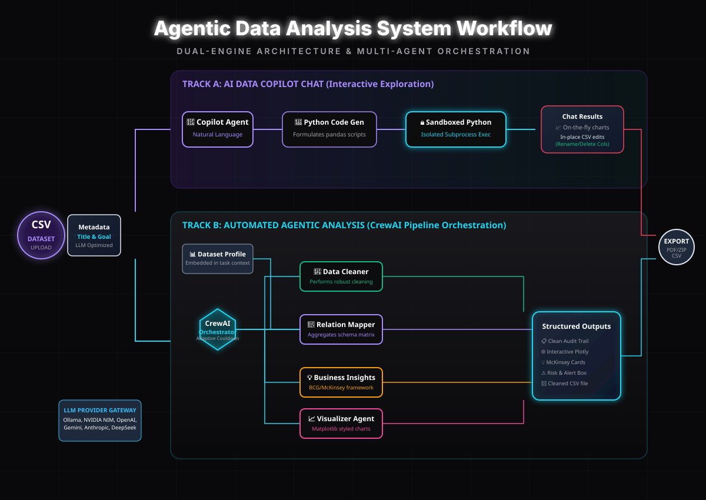

# Crewlyze Workflow & Pipeline Execution

Comprehensive breakdown of data flows, agent orchestration, and delivery pipelines within **Crewlyze**.

<p align="center">
  
</p>

---

## 🏗️ 1. Dual-Track Execution Architecture

Once a project dataset is ingested, Crewlyze offers two complementary, non-blocking operational tracks:

```text
                                  [Raw Dataset: CSV / Excel / SQLite]
                                                   │
                                                   ▼
                               ┌───────────────────────────────────────┐
                               │     Ingestion & Security Sandbox      │
                               │  - Encoding Auto-Detection (UTF-8/CP) │
                               │  - Path Traversal Validation          │
                               │  - Metadata Profiling & Session Init  │
                               └───────────────────┬───────────────────┘
                                                   │
                         ┌─────────────────────────┴─────────────────────────┐
                         ▼                                                   ▼
            ┌───────────────────────────┐                       ┌───────────────────────────┐
            │   TRACK A: AI COPILOT     │                       │   TRACK B: AGENT SWARM    │
            │   (Interactive Dialogue)  │                       │   (7-Agent CrewAI Swarm)  │
            ├───────────────────────────┤                       ├───────────────────────────┤
            │ • Non-blocking SSE stream │                       │ • Sequential 7-Agent Flow │
            │ • Slash '/' Column Picker │                       │ • Direct Relation Viz Fix │
            │ • Sub-second Custom Viz   │                       │ • Predictive & Anomaly ML │
            │ • Read-Only SQL Workbench │                       │ • Strategic SWOT Insights │
            └─────────────┬─────────────┘                       └─────────────┬─────────────┘
                          │                                                   │
                          └─────────────────────────┬─────────────────────────┘
                                                    │
                                                    ▼
                                   ┌─────────────────────────────────┐
                                   │   Output & Export Dispatcher    │
                                   │  - Interactive Plotly Dashboard │
                                   │  - Executive ReportLab PDF      │
                                   │  - PPTX, Notebook, ZIP Archives │
                                   │  - SMTP, Discord, Slack Alerts  │
                                   └─────────────────────────────────┘
```

---

## 🤖 2. Track B: The 7-Agent Autonomous Swarm

The core analysis pipeline coordinates 7 specialized AI agents in sequence:

```
[Raw Ingestion] ➔ [1. Cleaner] ➔ [2. Relations] ➔ [3. Visualizer] ➔ [4. Insights] ➔ [5. Anomaly] ➔ [6. Trend] ➔ [7. Predictive]
                                       │
                                       ▼
                       [Direct Fast-Execution Visuals Engine]
```

1. **🧹 Data Quality & Profiling Agent (`agents/cleaner.py`)**:
   - Evaluates missingness density (>60% threshold removal), imputes numeric/categorical nulls, standardizes headers, and strips formatting anomalies.
   - Generates the `diff` summary between original and cleaned dataset shapes.

2. **🔗 Relationship & Correlation Analyst (`agents/relation.py`)**:
   - Executes direct Python correlation matrices without stalling in multi-minute LLM loops.
   - Maps strong, moderate, and non-linear associations between features.

3. **🎨 Visual Intelligence Agent (`agents/visualizer.py`)**:
   - Writes and executes clean, styled Matplotlib/Seaborn plotting code in an isolated subprocess.
   - Produces high-resolution chart PNGs saved to `outputs/<session_id>/`.

4. **💼 Strategic Business Insights Agent (`agents/insights.py`)**:
   - Synthesizes findings into McKinsey-style consulting takeaways.
   - Formulates **Observation ➔ Business Implication ➔ Actionable Strategy** pillars with risk alerts.

5. **🚨 Anomaly & Risk Auditor Agent (`agents/anomaly.py`)**:
   - Evaluates IQR distribution spreads and Z-score thresholds to detect data spikes, fraudulent entries, and operational drift.

6. **📈 Temporal Trend Analyst Agent (`agents/trend.py`)**:
   - Evaluates date-stamped and time-indexed columns to determine directional momentum, growth velocity, and trajectory slopes.

7. **🤖 Predictive Auto-ML Specialist Agent (`agents/predictive.py`)**:
   - Trains automated machine learning models to rank feature importances and isolate primary business drivers.

---

## 💬 3. Track A: Real-Time AI Copilot Architecture

1. **Conversational Querying**: Ask questions about dataset metrics, distributions, or column anomalies in natural language.
2. **Slash `/` Autocomplete Dropdown**: Type `/` to dynamically inspect and autocomplete column names and data types.
3. **Sub-Second Visualization Engine (<0.2s)**: On-demand Matplotlib/Seaborn plot generation executed in an isolated child process via `subprocess.run()`.
4. **Chat Persistence**: Chat sessions and generated PNG chart cards are automatically preserved in `chat_history.json`.

---

## 📄 4. Export & Notification Delivery

1. **Executive ReportLab PDF (`ui/export.py`)**:
   - Multi-page PDF report with two-pass `NumberedCanvas` (page X of Y, headers, footers).
   - Embeds high-resolution chart images alongside executive KPI scorecards and SWOT matrices.
2. **Interactive Formats**:
   - Interactive Plotly dashboards with pan, zoom, and tooltip capabilities.
   - Downloadable Jupyter Notebook (`.ipynb`) and PowerPoint presentation (`.pptx`).
3. **Outbound Notification Dispatch (`config/llm_config.py` & `main.py`)**:
   - Transmits executive summaries and attached PDF reports via SMTP Email, Discord Webhooks, and Slack Webhooks.
